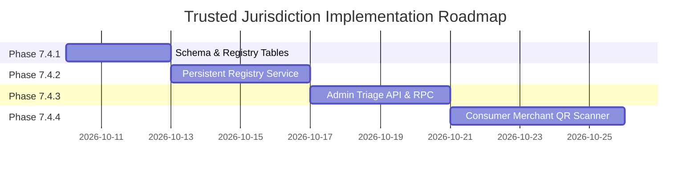

# PHASE 7.4: TRUSTED JURISDICTION DATA SOURCE DESIGN

## Executive Summary

Under the Legal Metrology Act, 2009 and the Legal Metrology (Packaged Commodities) Rules, 2011, statutory enforcement jurisdiction in India is strictly territorial:
1. **Manufacturer / Packer / Importer Violations (Rule 6, Rule 27):** Handled at the location of manufacturing, packaging, or primary corporate office.
2. **Retail Violations (Rule 18 Overcharging / Dual MRP, Rule 23 Smudging / Tampering):** Handled strictly by the Inspector of Legal Metrology having jurisdiction over the physical commercial establishment or retail premises where the retail sale, offer for sale, or tampering occurred.

In Veriqoo Phases 7.1–7.3, a fail-closed security boundary was established:
- Untrusted client inputs (client GPS coordinates, EXIF image metadata, unverified OCR address text, and user-selected dropdown states/districts) are explicitly disallowed from marking a complaint as verified (`jurisdiction_verified: false`, `state_code: null`, `district_code: null`).
- Unverified complaints remain fully readable by the reporting consumer (`/api/v1/consumer-issues/{id}`) but are completely hidden from authority queues (`/api/v1/authority/cases`) to prevent cross-jurisdiction leakage and arbitrary docket pollution.

This document specifies the authoritative data architecture, verification provenance, data model, administrative triage pipeline, security mitigations, and phased rollout necessary to bind consumer complaints to verified Legal Metrology jurisdictions without relying on client-supplied location claims.

---

## 1. Trace of Existing Sources & Current Baseline

### 1.1 Trace of All Location & Jurisdiction Sources in Repository

| Source | Field / Model | Persistence / Storage | Verifiability | Assessment & Risk |
|---|---|---|---|---|
| **Client Form Input** | `state_code`, `district_code` in `ConsumerIssueCreate` | Ignored by `IssueService` in Phase 7.1 | Unverified user input | **Zero trust.** Trivial to spoof via proxy tools or UI tampering. Cannot be used for authority routing. |
| **Client Device GPS** | `latitude`, `longitude` | Not persisted in DB schema | Read by mobile OS GPS | **Zero trust.** Spoofable via mock location apps, VPNs, or proxy headers. Physical GPS does not guarantee retail transaction locus (e.g., scanned at home after purchase). |
| **Image EXIF Metadata** | Camera metadata | Not stored in schema | Client-supplied file bytes | **Zero trust.** Stripped by messaging apps/social media; easily forged or absent. |
| **Gemini OCR Extracted Text** | `manufacturer_address`, `packer_address`, `consumer_care_address` | Parsed during compliance analysis | Model inference output | **Untrusted for retail violations.** Rule 6 declarations state where the good was packed (e.g., Silvassa or Kolkata), NOT where the retail overcharging or dual MRP violation occurred (e.g., Pune, MH). |
| **Local Government Directory (LGD)** | `CANONICAL_LGD_JURISDICTIONS` in `jurisdiction.py` | Python dictionary constant | Authoritative reference mapping | **Reference ontology only.** Standardizes ISO 3166-2:IN codes and LGD district slugs, but does NOT prove that a specific violation took place in that district. |
| **Server-Verified Location Registry** | `ServerVerifiedLocationRegistry` in `jurisdiction.py` | In-memory `dict[str, tuple[str, str]]` | Server-assigned | **Prototype placeholder.** Lost on server restart; lacks database persistence, foreign keys, or administrative onboarding workflows. |
| **Supabase `authority_profiles`** | `state_code`, `district_code`, `department` | Table `public.authority_profiles` | Server authenticated | **Authoritative for officers, NOT for premises.** Defines what an officer can inspect, but does not provide retail establishment identities. |

### 1.2 Authoritative Baseline Conclusion
No existing table or service in the current codebase provides an authoritative, persistent registry of retail premises linked to verified Legal Metrology jurisdictions. The current baseline correctly enforces:
```python
# backend/app/services/consumer_issues/service.py
resolved_jurisdiction = self.jurisdiction_resolver.resolve_jurisdiction(
    inspection_id=inspection_id,
    claimed_state_code=None,
    claimed_district_code=None,
)
```
Consequently, all consumer-reported issues currently default to `jurisdiction_verified = False`, preserving consumer read access while preventing unverified cases from appearing on any officer's dashboard.

---

## 2. Missing Components & Gap Analysis

To transition complaints from unverified to verified without compromising security, five fundamental architectural components are missing:

1. **Persistent Establishment & Premises Registry (`retail_establishments`):**
   - No table currently represents physical shops, registered Legal Metrology dealers/manufacturers, e-commerce fulfillment hubs, or commercial premises.
2. **Establishment Verification & Provenance System:**
   - No mechanism exists to tie an establishment to official Indian business registries:
     - GSTIN (Goods and Services Tax Identification Number via GST API/NIC portal)
     - Shop & Establishment Act Registration (Municipal Corporation records)
     - Legal Metrology Dealer/Manufacturer License Number (Form LM-1 / Form LM-2)
3. **Consumer-to-Premises Binding Vector:**
   - No trusted handshake links a consumer's camera scan or physical purchase to a verified establishment ID (e.g., cryptographically signed merchant QR code, verified e-invoice/e-way bill IRN scan).
4. **Central / State Administrative Triage Queue:**
   - No administrative workflow allows an authenticated State Nodal Officer or Central Legal Metrology Triage Officer to inspect supporting evidence (cash memos, tax invoices, purchase receipts) and authoritatively assign the jurisdiction.
5. **Atomic Jurisdiction Verification RPC:**
   - No audited database RPC exists to transition an issue from `jurisdiction_verified = false` to `true` while recording who authorized the routing.

---

## 3. Recommended Architecture: Dual-Vector Trusted Resolution

To reliably associate consumer complaints with verified jurisdictions, Veriqoo should implement a **Dual-Vector Trusted Jurisdiction Architecture**:

```
+--------------------------------------------------------------------------------------------------+
|                                     VERIQOO DUAL-VECTOR ARCHITECTURE                             |
+--------------------------------------------------------------------------------------------------+

  VECTOR 1: PHYSICAL PREMISES QR (Automated, Cryptographic)
  +-----------------------------------------------------------------------------------------------+
  |  Licensed Retailer Displays Legal Metrology Inspection Board QR Code                           |
  |  Contains: { establishment_id: UUID, signature: HMAC_SHA256(id, secret) }                     |
  |                                                                                               |
  |  Consumer Scans QR Code at Store -> Veriqoo Backend Validates Signature                       |
  |  Backend retrieves verified (state_code, district_code) from `retail_establishments`          |
  |  Issue created with `jurisdiction_verified = true` -> Instantly routed to Local Inspector     |
  +-----------------------------------------------------------------------------------------------+

  VECTOR 2: ADMINISTRATIVE TRIAGE & RECEIPT PROVENANCE (Semi-Automated / Manual)
  +-----------------------------------------------------------------------------------------------+
  |  Consumer Submits Complaint with Cash Memo / Tax Invoice Photo                                |
  |  Issue initially created with `jurisdiction_verified = false` (Pending Triage)                |
  |                                                                                               |
  |  Central / State Nodal Triage Officer inspects:                                               |
  |  - Seller GSTIN / Trade Name / Pos Invoice on Bill                                            |
  |  - Validates GSTIN/Address via National Trade Database / Registered Establishment Registry    |
  |                                                                                               |
  |  Officer executes atomic RPC: `authority_verify_complaint_jurisdiction()`                     |
  |  Sets `jurisdiction_verified = true`, `state_code`, `district_code`, `establishment_id`       |
  |  Issue now appears in target District Inspector's active docket with immutable audit record.   |
  +-----------------------------------------------------------------------------------------------+
```

### 3.1 Provenance Hierarchy
Under this architecture, jurisdiction verification is never an ungrounded string claim. It is backed by one of three provenance proofs:
1. `ESTABLISHMENT_QR`: Authenticated physical presence confirmed by scanning a tamper-evident, server-signed merchant QR code registered with Legal Metrology authorities.
2. `VERIFIED_GSTIN_INVOICE`: Extracted B2C/B2B invoice containing an authentic GSTIN and Invoice Reference Number (IRN) verified against the GST Suvidha Provider (GSP) / NIC portal.
3. `ADMIN_TRIAGE_VERIFICATION`: Explicit administrative review by a state-level Legal Metrology Nodal Officer who verifies proof of purchase and binds the complaint to an LGD district.

---

## 4. Data Model & Migration Proposal

### 4.1 New Table: `public.retail_establishments`
Stores verified commercial premises, government license details, and canonical LGD jurisdiction mapping.

```sql
-- Migration: supabase/migrations/20261015000000_trusted_retail_establishments.sql

CREATE TABLE IF NOT EXISTS public.retail_establishments (
    id UUID PRIMARY KEY DEFAULT gen_random_uuid(),
    trade_name TEXT NOT NULL,
    legal_name TEXT NOT NULL,
    gstin VARCHAR(15) UNIQUE,
    lm_license_number TEXT,
    shop_establishment_number TEXT,
    state_code VARCHAR(10) NOT NULL,
    district_code VARCHAR(50) NOT NULL,
    pincode VARCHAR(6) NOT NULL,
    physical_address TEXT NOT NULL,
    verification_status VARCHAR(30) NOT NULL DEFAULT 'PENDING'
        CHECK (verification_status IN ('PENDING', 'VERIFIED', 'SUSPENDED', 'REVOKED')),
    verification_authority_id UUID REFERENCES public.authority_profiles(id),
    verification_date TIMESTAMPTZ,
    verification_notes TEXT,
    qr_signing_key_id TEXT,
    created_at TIMESTAMPTZ NOT NULL DEFAULT timezone('utc'::text, now()),
    updated_at TIMESTAMPTZ NOT NULL DEFAULT timezone('utc'::text, now()),
    CONSTRAINT fk_retail_est_lgd CHECK (length(state_code) >= 2 AND length(district_code) >= 2)
);

CREATE INDEX idx_retail_establishments_jurisdiction 
    ON public.retail_establishments(state_code, district_code);
CREATE INDEX idx_retail_establishments_gstin 
    ON public.retail_establishments(gstin);
```

### 4.2 Updating `public.consumer_issues`
Enhance `consumer_issues` to link directly to the verified establishment and provenance metadata:

```sql
-- Migration addition to public.consumer_issues
ALTER TABLE public.consumer_issues
    ADD COLUMN IF NOT EXISTS establishment_id UUID REFERENCES public.retail_establishments(id),
    ADD COLUMN IF NOT EXISTS jurisdiction_provenance VARCHAR(50) DEFAULT 'UNVERIFIED'
        CHECK (jurisdiction_provenance IN ('UNVERIFIED', 'ESTABLISHMENT_QR', 'VERIFIED_GSTIN_INVOICE', 'ADMIN_TRIAGE_VERIFICATION')),
    ADD COLUMN IF NOT EXISTS jurisdiction_verified_at TIMESTAMPTZ,
    ADD COLUMN IF NOT EXISTS jurisdiction_verified_by UUID REFERENCES public.authority_profiles(id);

CREATE INDEX idx_consumer_issues_establishment 
    ON public.consumer_issues(establishment_id);
CREATE INDEX idx_consumer_issues_triage_queue 
    ON public.consumer_issues(jurisdiction_verified, status) 
    WHERE jurisdiction_verified = false;
```

### 4.3 Atomic Database RPC for Jurisdiction Verification
This `SECURITY DEFINER` function allows only authorized State/Central Nodal Officers to assign jurisdiction:

```sql
-- Migration: Atomic Jurisdiction Verification RPC
CREATE OR REPLACE FUNCTION public.authority_verify_complaint_jurisdiction(
    p_issue_id UUID,
    p_establishment_id UUID,
    p_state_code TEXT,
    p_district_code TEXT,
    p_provenance TEXT,
    p_notes TEXT
)
RETURNS JSONB
LANGUAGE plpgsql
SECURITY DEFINER
SET search_path = public, pg_temp
AS $$
DECLARE
    v_officer_id UUID;
    v_officer_state TEXT;
    v_officer_district TEXT;
    v_officer_dept TEXT;
    v_is_active BOOLEAN;
    v_issue_record RECORD;
    v_est_record RECORD;
BEGIN
    -- 1. Identify and authenticate calling officer
    SELECT id, state_code, district_code, department, is_active
      INTO v_officer_id, v_officer_state, v_officer_district, v_officer_dept, v_is_active
      FROM public.authority_profiles
     WHERE user_id = auth.uid();

    IF v_officer_id IS NULL OR v_is_active IS NOT TRUE THEN
        RAISE EXCEPTION 'UNAUTHORIZED: Calling officer is not an active authority profile.';
    END IF;

    -- Only State Nodal or Central Triage officers can assign jurisdiction
    IF v_officer_dept NOT IN ('STATE_NODAL', 'CENTRAL_HQ', 'TRIAGE_DESK') THEN
        RAISE EXCEPTION 'FORBIDDEN: Only State Nodal or Central Triage officers may verify jurisdiction.';
    END IF;

    -- 2. Lock and fetch consumer issue
    SELECT * INTO v_issue_record
      FROM public.consumer_issues
     WHERE id = p_issue_id
       FOR UPDATE;

    IF v_issue_record.id IS NULL THEN
        RAISE EXCEPTION 'NOT_FOUND: Consumer issue % does not exist.', p_issue_id;
    END IF;

    -- 3. Validate establishment (if provided)
    IF p_establishment_id IS NOT NULL THEN
        SELECT * INTO v_est_record
          FROM public.retail_establishments
         WHERE id = p_establishment_id;

        IF v_est_record.id IS NULL OR v_est_record.verification_status != 'VERIFIED' THEN
            RAISE EXCEPTION 'INVALID_ESTABLISHMENT: Establishment is not verified.';
        END IF;

        -- Ensure state and district match the verified establishment
        p_state_code := v_est_record.state_code;
        p_district_code := v_est_record.district_code;
    END IF;

    -- 4. Apply updates
    UPDATE public.consumer_issues
       SET jurisdiction_verified = TRUE,
           state_code = p_state_code,
           district_code = p_district_code,
           establishment_id = p_establishment_id,
           jurisdiction_provenance = p_provenance,
           jurisdiction_verified_at = timezone('utc'::text, now()),
           jurisdiction_verified_by = v_officer_id,
           updated_at = timezone('utc'::text, now())
     WHERE id = p_issue_id;

    -- 5. Record immutable audit entry
    INSERT INTO public.authority_case_audit (
        issue_id,
        action,
        from_status,
        to_status,
        performed_by,
        reason,
        metadata
    ) VALUES (
        p_issue_id,
        'JURISDICTION_VERIFIED',
        v_issue_record.status,
        v_issue_record.status,
        v_officer_id,
        p_notes,
        jsonb_build_object(
            'provenance', p_provenance,
            'state_code', p_state_code,
            'district_code', p_district_code,
            'establishment_id', p_establishment_id
        )
    );

    RETURN jsonb_build_object(
        'success', TRUE,
        'issue_id', p_issue_id,
        'state_code', p_state_code,
        'district_code', p_district_code,
        'provenance', p_provenance
    );
END;
$$;
```

---

## 5. Verification & Administrative Workflows

### 5.1 Retail Premises Registration & Verification Lifecycle
To prevent malicious entities from registering fake shops to divert complaints, premises registration must follow a strict administrative workflow:

```
[Retailer / Field Inspector]
            |
            v
1. Submit Onboarding Application (Trade Name, GSTIN, Form LM-1, Municipal License, Geo-Boundary)
            |
            v
2. Automated Validation against GST API / MCA21 Registry
            |
            v
3. District Legal Metrology Inspector Field Verification (Spot inspection of weighing instruments & licenses)
            |
            v
4. Approval & Issuance of Cryptographic Merchant QR Code by State Controller
            |
            v
5. Establishment Status -> 'VERIFIED'
```

### 5.2 Handling Flawed / Invalid Jurisdiction Data
The system must explicitly manage edge cases without dropping consumer complaints:

| Scenario | Resolution Rule | Officer Queue Visibility | Consumer Status Display |
|---|---|---|---|
| **Missing Location Data** | Complaint recorded with `jurisdiction_verified: false` | Displayed only in Central/State Triage Queue | "Under Initial Review (Verifying Retailer)" |
| **Conflicting Claims (GPS != Receipt)** | Evidence on physical receipt/invoice supersedes GPS or user claim | Triage officer manually verifies invoice address against LGD directory | "Pending Administrative Jurisdiction Review" |
| **Outdated / Redistricted District** | System maps legacy district names to current 2026 LGD code via automated canonical synonym lookup | Once mapped, routed to newly constituted district inspector | "Assigned to [Current District] Inspectorate" |
| **Out-of-State / Cross-Border Sale** | Jurisdiction assigned to district where retail sale was consummated, with secondary advisory notice to manufacturer's district | Primary: Retail District Officer; Secondary: Manufacturer District Officer | "Forwarded to Enforcement Division" |
| **Unresolvable / Fraudulent Claim** | Triage officer rejects complaint or marks `REJECTED_UNRESOLVABLE` | Removed from active inspection docket; archived in audit records | "Closed: Insufficient Proof of Purchase / Location" |

---

## 6. Security Threat Model & Mitigations

### 6.1 Threat Vectors & Defenses

1. **Threat 1: GPS Mocking & Location Spoofing**
   - *Attack:* A bad actor uses Android Mock Locations or modified APKs to submit false complaints against a rival store in another state.
   - *Defense:* GPS is completely discarded for routing decisions. Only cryptographic QR scans or verified invoice GSTINs can set `jurisdiction_verified = true`.

2. **Threat 2: QR Code Hijacking & Clone Attacks**
   - *Attack:* An attacker photographs a store's Legal Metrology QR code and publishes it online for remote consumers to scan.
   - *Defense:* The QR code payload includes a rotating timestamped nonce and time-based cryptographic token generated by the Veriqoo Merchant Terminal, or requires matching transaction ID/cash memo timestamp within an acceptable time window (e.g., 2 hours).

3. **Threat 3: Cross-District Unauthorized Officer Access**
   - *Attack:* An officer in Pune attempts to view or modify a Mumbai Suburban complaint via direct API manipulation (`GET /api/v1/authority/cases/{mumbai_issue_id}`).
   - *Defense:* Enforced at two independent layers:
     - `AuthorityPolicy.can_access_case()` raises `403 AuthorityJurisdictionDeniedError`.
     - PostgreSQL Row Level Security (RLS) on `consumer_issues` and `authority_case_audit` restricts read/write queries to `authority_profiles.state_code = consumer_issues.state_code AND authority_profiles.district_code = consumer_issues.district_code`.

4. **Threat 4: Privilege Escalation via Profile Manipulation**
   - *Attack:* A consumer attempts to set `department = 'CENTRAL_HQ'` on their user profile to access administrative triage endpoints.
   - *Defense:* Authority profiles cannot be created or edited via public APIs. `public.authority_profiles` has no public `INSERT` or `UPDATE` policy; officer provisioning is restricted to database administrators or dedicated intranet management commands.

5. **Threat 5: Leakage of Consumer Private Data to Unverified Authorities**
   - *Attack:* An unverified complaint containing consumer phone numbers or photos is broadcast to all officers.
   - *Defense:* Fail-closed filter: `WHERE jurisdiction_verified = TRUE` is hardcoded into `CaseRepository.list_cases` and PostgreSQL RLS. Only the submitting consumer and authenticated triage officers can access the record.

---

## 7. Incremental Implementation Roadmap



### Phase 7.4.1: Database Foundation & Migrations (Target: Week 1)
- Create migration `20261015000000_trusted_retail_establishments.sql`.
- Add `public.retail_establishments` and foreign key fields on `consumer_issues`.
- Implement `public.authority_verify_complaint_jurisdiction` RPC with row locking and audit logging.
- Add PostgreSQL RLS policies for `retail_establishments` (public read-only for verified, write-restricted to authorized officers).

### Phase 7.4.2: Backend Persistent Registry Service (Target: Week 2)
- Replace `ServerVerifiedLocationRegistry` in-memory dictionary in `jurisdiction.py` with `DatabaseJurisdictionResolver` querying `retail_establishments`.
- Implement GSTIN verification client interface (mockable in testing, integrating with National Portal in production).
- Add repository methods for establishment lookups by UUID, GSTIN, and municipal license.

### Phase 7.4.3: Administrative Triage Endpoints & Dashboard Queue (Target: Week 3)
- Implement `/api/v1/authority/triage/queue` endpoint restricted to `STATE_NODAL` and `CENTRAL_HQ` departments.
- Implement `/api/v1/authority/triage/{issue_id}/verify-jurisdiction` endpoint calling the atomic RPC.
- Add triage review interface to Flutter Authority Dashboard for Nodal officers.

### Phase 7.4.4: Consumer Merchant QR Scanning Flow (Target: Week 4)
- Add optional "Scan Store QR" button in Flutter `ReportViolationDialog`.
- Verify QR signature on backend before associating `establishment_id` with `inspection_sessions`.
- Deliver instantaneous verification and routing for QR-backed reports.

---

## 8. Test Strategy & Acceptance Criteria Before Deployment

Before deploying any live jurisdiction resolution code, the test suite must enforce the following matrix:

| Test Category | Test Case | Expected Behavior |
|---|---|---|
| **Valid Jurisdiction** | Issue linked to verified establishment via QR code | `jurisdiction_verified: true`, `state_code: "MH"`, `district_code: "PUNE"`. Case visible in Pune inspector's docket. |
| **Unresolved Jurisdiction** | Issue created without verified establishment or QR | `jurisdiction_verified: false`, `state_code: null`, `district_code: null`. Case invisible in all district dockets; visible only to consumer and State Triage. |
| **Cross-District Access** | Officer in Mumbai attempts to read or assign a Pune case | Backend raises `403 AuthorityJurisdictionDeniedError`. RLS blocks SQL read. |
| **Unauthorized Verification** | District Inspector attempts to call `verify_complaint_jurisdiction` RPC | RPC raises `FORBIDDEN: Only State Nodal or Central Triage officers may verify jurisdiction`. |
| **Revoked Authority** | Officer with `is_active: false` attempts case operations | API returns `401 Unauthorized` / `403 Forbidden`. |
| **Consumer Access Preservation** | Consumer queries their own complaint (`jurisdiction_verified: false`) | Returns full complaint detail with status `SUBMITTED` and triage progress indicator. |
| **Tampered QR Code** | Consumer submits forged establishment UUID or invalid HMAC | Backend rejects QR payload; falls back to unverified complaint triage. |
| **Duplicate / Ambiguous District** | Submitting district "Bilaspur" (exists in both CG and HP) | Verification fails unless qualified by canonical ISO state code (`CG-BILASPUR` vs `HP-BILASPUR`). |

---

## 9. Conclusion & Immediate Recommendations

1. **Maintain Current Fail-Closed Posture:**
   The current behavior (ignoring client-submitted location and marking complaints unverified) is strictly correct and must be preserved until the persistent `retail_establishments` table and triage RPC are deployed.
2. **Prioritize Administrative Triage Over Complex Geo-fencing:**
   GPS and geo-fencing provide zero legal standing under Indian evidence rules for Legal Metrology offenses. The administrative triage of purchase invoices and government-backed merchant QR codes provides an indisputable chain of custody and statutory compliance.
3. **Keep Consumer Experience Informative:**
   Ensure the mobile UI displays clear status messaging ("Complaint submitted and queued for retailer jurisdiction review") rather than giving the false impression that a local officer has already been assigned.
