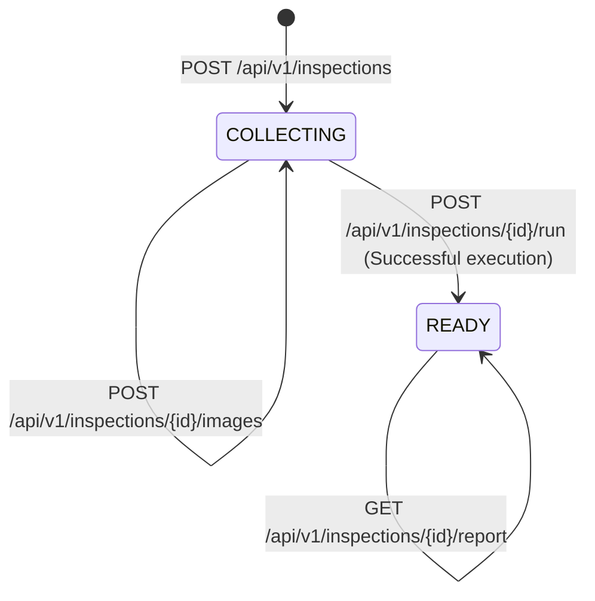

# Veriqoo Backend API Contract & Integration Specification

**Version:** 1.0.0  
**Target Audience:** Flutter Frontend Engineering & API Integrators  
**Scope:** Phase 9A — API Contract Freeze & Integration Specification  
**Status:** **FROZEN & STABLE**

---

## 1. API Base URL & Environment Configuration

| Environment | Base URL | Notes |
|:---|:---|:---|
| **Local Development** | `http://127.0.0.1:8000` or `http://localhost:8000` | Run locally via `uvicorn backend.app.main:app` |
| **Android Emulator** | `http://10.0.2.2:8000` | Loopback IP for Android Studio emulator |
| **iOS Simulator** | `http://127.0.0.1:8000` | Standard macOS loopback |
| **Physical Device (LAN)** | `http://<HOST_IP>:8000` | Ensure host firewall allows inbound port 8000 |

### OpenAPI Interactive Documentation
- **Swagger UI:** `GET /docs`
- **ReDoc:** `GET /redoc`
- **Canonical OpenAPI 3.1 JSON Specification:** `GET /openapi.json`

---

## 2. Authentication & Authorization Status

> [!IMPORTANT]
> **Authentication / RBAC Status:** **NOT YET IMPLEMENTED (Phase 9A Out-of-Scope).**
> - All `/api/v1/...` endpoints are currently unauthenticated.
> - Do not transmit `Authorization: Bearer <token>` headers or session cookies unless specified in future milestones.
> - The inspector context (e.g. `officer_id`, `district_code`) is passed via optional `metadata` in `POST /api/v1/inspections`.

---

## 3. Inspection Lifecycle State Machine

An inspection container progresses through a deterministic two-state lifecycle:



### Lifecycle Enums & Rules
- **`COLLECTING`:** The inspection session is active and open for package photographs. Images can be added sequentially.
- **`READY`:** The verification pipeline has executed and generated an authoritative `InspectionReport`. The session is sealed; subsequent image uploads are **rejected with HTTP 409 (`INVALID_INSPECTION_STATE`)**.

---

## 4. API Endpoints Table

| HTTP Method | Route | Summary | Accepted Input | Output Schema | HTTP Statuses |
|:---|:---|:---|:---|:---|:---:|
| `GET` | `/health` | Root Health Probe | None | `HealthResponse` | `200` |
| `GET` | `/api/v1/health` | API v1 Health Probe | None | `HealthResponse` | `200` |
| `POST` | `/api/v1/inspections` | Create Inspection Session | JSON (`CreateInspectionRequest`) | `InspectionResponse` | `201`, `400`, `422` |
| `GET` | `/api/v1/inspections/{id}` | Get Inspection State | Path parameter `{id}` | `InspectionResponse` | `200`, `404` |
| `POST` | `/api/v1/inspections/{id}/images` | Upload Package Photo | `multipart/form-data` (`file`) | `ImageUploadResponse` | `201`, `400`, `404`, `409`, `413`, `415` |
| `POST` | `/api/v1/inspections/{id}/run` | Execute Verification Pipeline | JSON (`RunInspectionRequest`) | `InspectionReportResponse` | `200`, `400`, `404`, `500` |
| `GET` | `/api/v1/inspections/{id}/report` | Retrieve Verification Report | Path parameter `{id}` | `InspectionReportResponse` | `200`, `404` |

---

## 5. Controlled Vocabularies & Status Enums

### 5.1 Inspection Status (`InspectionStatus`)
- `COLLECTING`: Accepting new image uploads.
- `READY`: Inspection pipeline completed; report generated; sealed.

### 5.2 Overall Report Status (`OverallInspectionStatus`)
- `PASS`: Every applicable legal requirement is satisfied (`PASS` or `NOT_APPLICABLE`).
- `FAIL`: One or more applicable legal requirements failed compliance (`FAIL`).
- `REVIEW_REQUIRED`: Ambiguous evidence, illegible text, missing mandatory views, or manual officer review required.

### 5.3 Requirement Verification Status (`VerificationStatus`)
- `PASS`: Statutory declaration verified as fully compliant.
- `FAIL`: Mandatory declaration is missing, inaccurate, or violating statutory rules.
- `NOT_VISIBLE`: Declaration field not found on any uploaded package surfaces.
- `NOT_APPLICABLE`: Requirement does not apply to this commodity category.
- `REVIEW_REQUIRED`: Low OCR confidence, conflicting evidence, or borderlines.

### 5.4 Standard Error Codes (`ErrorCode`)
- `INVALID_REQUEST` (`400`, `422`): Request schema validation error or malformed parameters.
- `INSPECTION_NOT_FOUND` (`404`): The specified `inspection_id` does not exist.
- `INVALID_INSPECTION_STATE` (`409`): Action illegal in current state (e.g. uploading to a `READY` session).
- `IMAGE_EMPTY` (`400`): Uploaded file contains 0 bytes.
- `INVALID_IMAGE` (`400`): Corrupt, unreadable, or truncated image bytes.
- `IMAGE_TOO_LARGE` (`413`): Exceeds 25 MB or 32 Megapixel safety limit.
- `IMAGE_UNSUPPORTED` (`415`): File format is not JPEG, PNG, or WEBP.
- `REPORT_NOT_AVAILABLE` (`404`): `/report` called before pipeline execution.
- `PIPELINE_ERROR` (`500`): Execution failure within the verification engine.
- `INTERNAL_ERROR` (`500`): Unexpected server error.

---

## 6. Standard Error Format

All error responses from the backend follow a consistent JSON envelope:

```json
{
  "error": {
    "code": "INSPECTION_NOT_FOUND",
    "message": "Inspection with ID '7c9e6679-7425-40de-944b-e07fc1f90ae7' not found.",
    "details": {
      "inspection_id": "7c9e6679-7425-40de-944b-e07fc1f90ae7"
    }
  }
}
```

---

## 7. Detailed Endpoint Specifications

### 7.1 `GET /health` & `GET /api/v1/health`
Lightweight service health probes. Zero database or downstream model invocations.

**Response (`200 OK`):**
```json
{
  "status": "ok",
  "service": "LegalMetrologyAI Backend",
  "api_version": "1.0.0"
}
```

---

### 7.2 `POST /api/v1/inspections`
Initializes a new inspection container in `COLLECTING` state.

**Request Body (`application/json`):**
```json
{
  "metadata": {
    "officer_id": "OFFICER_42",
    "location": "Warehouse A, Sector 9",
    "retailer_name": "Metro Retailers Ltd"
  },
  "inspection_date": "2026-10-04"
}
```

**Response (`201 Created`):**
```json
{
  "inspection_id": "7c9e6679-7425-40de-944b-e07fc1f90ae7",
  "created_at": "2026-10-04T05:00:00+00:00",
  "status": "COLLECTING",
  "image_count": 0,
  "images": [],
  "metadata": {
    "officer_id": "OFFICER_42",
    "location": "Warehouse A, Sector 9",
    "retailer_name": "Metro Retailers Ltd",
    "inspection_date": "2026-10-04"
  },
  "has_report": false
}
```

---

### 7.3 `GET /api/v1/inspections/{inspection_id}`
Retrieves the container state, lifecycle status, and ordered image references.

**Response (`200 OK`):**
```json
{
  "inspection_id": "7c9e6679-7425-40de-944b-e07fc1f90ae7",
  "created_at": "2026-10-04T05:00:00+00:00",
  "status": "COLLECTING",
  "image_count": 2,
  "images": [
    {
      "image_id": "a1b2c3d4-e5f6-7890-abcd-ef1234567890",
      "sequence": 1,
      "added_at": "2026-10-04T05:01:00+00:00",
      "source_hash": "e3b0c44298fc1c149afbf4c8996fb92427ae41e4649b934ca495991b7852b855",
      "normalized_hash": "ca978112ca1bbdcafac231b39a23dc4da786eff8147c4e72b9807785afee48bb"
    },
    {
      "image_id": "b2c3d4e5-f6a7-8901-bcde-f12345678901",
      "sequence": 2,
      "added_at": "2026-10-04T05:02:00+00:00",
      "source_hash": "8729832049823049823094820394820394820394820394820394820394820394",
      "normalized_hash": "9382049820394820394820394820394820394820394820394820394820394820"
    }
  ],
  "metadata": {
    "officer_id": "OFFICER_42"
  },
  "has_report": false
}
```

---

### 7.4 `POST /api/v1/inspections/{inspection_id}/images`
Uploads, validates, and normalizes a package photograph into the inspection container.

**Content-Type:** `multipart/form-data`  
**Field:** `file` (Binary stream of JPEG, PNG, or WEBP photograph)

**Constraints:**
- Allowed formats: `image/jpeg`, `image/png`, `image/webp`.
- Maximum file size: 25 MB.
- Maximum dimensions: 8192 $\times$ 8192 pixels (32 Megapixels).
- Automatic EXIF orientation correction is applied.
- Normalized to RGB color space.

**Response (`201 Created`):**
```json
{
  "image_id": "a1b2c3d4-e5f6-7890-abcd-ef1234567890",
  "sequence": 1,
  "source_hash": "e3b0c44298fc1c149afbf4c8996fb92427ae41e4649b934ca495991b7852b855",
  "normalized_hash": "ca978112ca1bbdcafac231b39a23dc4da786eff8147c4e72b9807785afee48bb",
  "source_format": "JPEG",
  "normalized_format": "PNG",
  "original_width": 3000,
  "original_height": 2000,
  "normalized_width": 2560,
  "normalized_height": 1707,
  "file_size_bytes": 1420580,
  "source_file_size_bytes": 2104920,
  "color_mode": "RGB",
  "was_resized": true,
  "was_orientation_corrected": false
}
```

---

### 7.5 `POST /api/v1/inspections/{inspection_id}/run`
Triggers the Phase 7 unified 10-step verification orchestrator across all uploaded photos.

**Execution Characteristics:**
- **Synchronous Execution:** The HTTP request blocks until pipeline completion.
- **Completed Run Idempotency:** If the inspection was already executed and has a report, the backend immediately returns the cached report without re-executing OCR or Gemini.
- **Concurrency Mutex:** Process-local locking prevents duplicate simultaneous execution on the same server instance.

**Request Body (`application/json`, all fields optional):**
```json
{
  "inspection_facts": [
    {
      "fact_key": "commodity_type",
      "value": "prepackaged_food"
    }
  ],
  "applicability_context": {},
  "target_requirements": ["R-6-1-a", "R-6-1-b", "R-6-1-c"],
  "metadata": {}
}
```

**Response (`200 OK`):**
```json
{
  "inspection_id": "7c9e6679-7425-40de-944b-e07fc1f90ae7",
  "overall_status": "PASS",
  "summary": "All statutory declarations verified compliant under PCR 2011.",
  "counts": {
    "image_count": 2,
    "evidence_count": 6,
    "applicable_requirement_count": 3,
    "pass_count": 3,
    "fail_count": 0,
    "not_visible_count": 0,
    "not_applicable_count": 0,
    "review_required_count": 0
  },
  "verification_results": [
    {
      "verification_id": "v_7c9e6679-7425-40de-944b-e07fc1f90ae7_R-6-1-a",
      "requirement_id": "R-6-1-a",
      "applicability_decision_id": null,
      "status": "PASS",
      "reason": "Manufacturer declaration 'Manufactured by ABC Foods Pvt Ltd' clearly visible.",
      "confidence": 0.98,
      "review_required": false,
      "evidence_ids": ["ev_mfg_1"],
      "source_observation_ids": ["obs_1"],
      "image_ids": ["a1b2c3d4-e5f6-7890-abcd-ef1234567890"],
      "metadata": {
        "rule_source": "Rule 6(1)(a)"
      },
      "created_at": "2026-10-04T05:05:00+00:00"
    }
  ],
  "errors": [],
  "created_at": "2026-10-04T05:05:00+00:00",
  "metadata": {
    "schema_version": "1.0.0"
  }
}
```

---

### 7.6 `GET /api/v1/inspections/{inspection_id}/report`
Retrieves the persisted verification report. Returns `404 REPORT_NOT_AVAILABLE` if the pipeline has not yet been executed.

**Response (`200 OK`):** Exactly identical to the payload returned by `POST .../run`.

---

## 8. Flutter Integration Guidance

### 8.1 Typical Mobile Inspection Workflow
1. **Initialize Session:** Call `POST /api/v1/inspections` when the inspector starts a new package scan. Store the returned `inspection_id`.
2. **Capture Photos:** Inspector takes front, back, top, bottom, and side photos of the package.
3. **Upload Photos:** For each photo, call `POST /api/v1/inspections/{id}/images` with `multipart/form-data`. Handle `sequence` and verify `was_resized`.
4. **Execute Verification:** Call `POST /api/v1/inspections/{id}/run`. Display a loading spinner in the Flutter UI.
5. **Display Results:** Render the `overall_status` badge (Green for `PASS`, Red for `FAIL`, Amber for `REVIEW_REQUIRED`) and display individual requirement compliance items.
6. **Report Re-access:** If the inspector navigates back or checks history, call `GET /api/v1/inspections/{id}/report`.

### 8.2 Client Timeout & Network Retry Policy
- Photo uploads (`/images`): Configure a minimum timeout of **30 seconds**.
- Verification pipeline (`/run`): The pipeline performs PaddleOCR inference and Gemini reasoning synchronously; configure a minimum HTTP client timeout of **60 seconds**.
- Retry Policy: Because `/run` is idempotent, network timeouts during `/run` can safely retry by calling `GET .../report` or `POST .../run` again without duplicate billing or re-execution.

---

## 9. Current Known Architectural Limitations

1. **Image Binary Persistence:** Phase 8B/9A persists image metadata, hashes, dimensions, and sequences in PostgreSQL, but **does not provide durable object binary storage across process restarts**. Image binaries reside in volatile memory for the active session.
2. **Process-Local Concurrency:** Concurrency protection uses a process-local mutex (`threading.Lock`), not a distributed lock.
3. **Authentication:** User login, JWT validation, and RBAC are deferred to future milestones.

---

## 10. Integration Checklist for Flutter Teammate

- [ ] Configure `http` or `dio` client base URL pointing to the appropriate environment host.
- [ ] Implement `multipart/form-data` image upload using `file` field name.
- [ ] Enforce client-side image format restrictions to JPEG, PNG, or WEBP before upload.
- [ ] Handle structured HTTP error envelopes (`response.data['error']['code']`).
- [ ] Set read timeout $\ge 60$ seconds on `POST /api/v1/inspections/{id}/run`.
- [ ] Map `overall_status` and `status` to UI themes based on `PASS`, `FAIL`, and `REVIEW_REQUIRED`.

