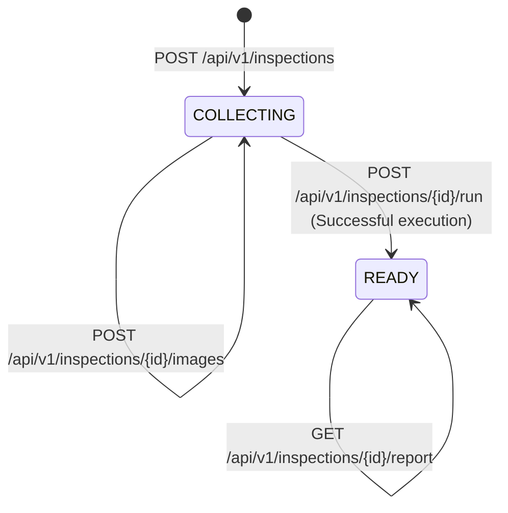

# Veriqoo Backend API Contract & Integration Specification

**Version:** 1.0.0  
**Target Audience:** Flutter Frontend Engineering & API Integrators  
**Scope:** Phase 9A — API Contract Freeze & Integration Specification  
**Status:** **FROZEN & STABLE**

---

## 1. API Base URL & Environment Configuration

| Environment | Base URL | Notes |
|:---|:---|:---|
| **Local Development** | `http://127.0.0.1:8000` or `http://localhost:8000` | Run locally via `uvicorn backend.app.main:app` |
| **Android Emulator** | `http://10.0.2.2:8000` | Loopback IP for Android Studio emulator |
| **iOS Simulator** | `http://127.0.0.1:8000` | Standard macOS loopback |
| **Physical Device (LAN)** | `http://<HOST_IP>:8000` | Ensure host firewall allows inbound port 8000 |

### OpenAPI Interactive Documentation
- **Swagger UI:** `GET /docs`
- **ReDoc:** `GET /redoc`
- **Canonical OpenAPI 3.1 JSON Specification:** `GET /openapi.json`

---

## 2. Authentication & Authorization Status

> [!IMPORTANT]
> **Authentication / RBAC Status:** **NOT YET IMPLEMENTED (Phase 9A Out-of-Scope).**
> - All `/api/v1/...` endpoints are currently unauthenticated.
> - Do not transmit `Authorization: Bearer <token>` headers or session cookies unless specified in future milestones.
> - The inspector context (e.g. `officer_id`, `district_code`) is passed via optional `metadata` in `POST /api/v1/inspections`.

---

## 3. Inspection Lifecycle State Machine

An inspection container progresses through a deterministic two-state lifecycle:



### Lifecycle Enums & Rules
- **`COLLECTING`:** The inspection session is active and open for package photographs. Images can be added sequentially.
- **`READY`:** The verification pipeline has executed and generated an authoritative `InspectionReport`. The session is sealed; subsequent image uploads are **rejected with HTTP 409 (`INVALID_INSPECTION_STATE`)**.

---

## 4. API Endpoints Table

| HTTP Method | Route | Summary | Accepted Input | Output Schema | HTTP Statuses |
|:---|:---|:---|:---|:---|:---:|
| `GET` | `/health` | Root Health Probe | None | `HealthResponse` | `200` |
| `GET` | `/api/v1/health` | API v1 Health Probe | None | `HealthResponse` | `200` |
| `POST` | `/api/v1/inspections` | Create Inspection Session | JSON (`CreateInspectionRequest`) | `InspectionResponse` | `201`, `400`, `422` |
| `GET` | `/api/v1/inspections` | List User Scan History | Query params (`limit`, `offset`) | `InspectionListResponse` | `200`, `401` |
| `GET` | `/api/v1/inspections/{id}` | Get Inspection State | Path parameter `{id}` | `InspectionResponse` | `200`, `404` |
| `POST` | `/api/v1/inspections/{id}/images` | Upload Package Photo | `multipart/form-data` (`file`) | `ImageUploadResponse` | `201`, `400`, `404`, `409`, `413`, `415` |
| `POST` | `/api/v1/inspections/{id}/run` | Execute Verification Pipeline | JSON (`RunInspectionRequest`) | `InspectionReportResponse` | `200`, `400`, `404`, `500` |
| `GET` | `/api/v1/inspections/{id}/report` | Retrieve Verification Report | Path parameter `{id}` | `InspectionReportResponse` | `200`, `404` |
| `GET` | `/api/v1/users/me` | Get Authenticated User Profile | None | `UserProfileResponse` | `200`, `401` |
| `PATCH` | `/api/v1/users/me` | Update User Profile | JSON (`UpdateUserProfileRequest`) | `UserProfileResponse` | `200`, `401`, `422` |
| `POST` | `/api/v1/saved-products` | Save Product from Inspection | JSON (`SaveProductRequest`) | `SavedProductResponse` | `201`, `400`, `401`, `404` |
| `GET` | `/api/v1/saved-products` | List Saved Products | Query params (`limit`, `offset`) | `PaginatedSavedProductsResponse` | `200`, `401` |
| `DELETE` | `/api/v1/saved-products/{saved_product_id}` | Delete Saved Product | Path parameter `{saved_product_id}` | None (`204 No Content`) | `204`, `401`, `404` |
| `POST` | `/api/v1/consumer-issues` | Submit Consumer Issue Report | JSON (`CreateConsumerIssueRequest`) | `ConsumerIssueResponse` | `201`, `400`, `401`, `404`, `409` |
| `GET` | `/api/v1/consumer-issues` | List Consumer Issues | Query params (`limit`, `offset`, `status`) | `PaginatedConsumerIssuesResponse` | `200`, `401` |
| `GET` | `/api/v1/consumer-issues/{issue_id}` | Get Consumer Issue Details | Path parameter `{issue_id}` | `ConsumerIssueResponse` | `200`, `401`, `404` |
| `DELETE` | `/api/v1/consumer-issues/{issue_id}` | Withdraw Consumer Issue Report | Path parameter `{issue_id}` | None (`204 No Content`) | `204`, `401`, `404`, `409` |
| `GET` | `/api/v1/authority/cases` | List Authority Complaint Queue | Query params (`status`, `issue_type`, `assigned`, `my_cases`, `limit`, `offset`) | `CaseListResponse` | `200`, `401`, `403` |
| `GET` | `/api/v1/authority/cases/{case_id}` | Get Authority Case Details | Path parameter `{case_id}` | `CaseDetailResponse` | `200`, `401`, `403`, `404` |
| `POST` | `/api/v1/authority/cases/{case_id}/assign` | Assign Primary Officer | Path parameter `{case_id}`, JSON (`CaseAssignRequest`) | `CaseAssignResponse` | `200`, `401`, `403`, `404`, `422` |
| `GET` | `/api/v1/authority/cases/{case_id}/notes` | List Internal Investigation Notes | Path parameter `{case_id}` | `CaseNotesListResponse` | `200`, `401`, `403`, `404` |
| `POST` | `/api/v1/authority/cases/{case_id}/notes` | Add Internal Investigation Note | Path parameter `{case_id}`, JSON (`CreateCaseNoteRequest`) | `CaseNoteResponse` | `201`, `401`, `403`, `404`, `422` |
| `PATCH` | `/api/v1/authority/cases/{case_id}/status` | Transition Case Status | Path parameter `{case_id}`, JSON (`CaseStatusTransitionRequest`) | `CaseStatusTransitionResponse` | `200`, `401`, `403`, `404`, `409`, `422` |
| `GET` | `/api/v1/authority/cases/{case_id}/audit-timeline` | View Case Audit Timeline | Path parameter `{case_id}` | `CaseAuditTimelineResponse` | `200`, `401`, `403`, `404` |

---

## 5. Controlled Vocabularies & Status Enums

### 5.1 Inspection Status (`InspectionStatus`)
- `COLLECTING`: Accepting new image uploads.
- `READY`: Inspection pipeline completed; report generated; sealed.

### 5.2 Overall Report Status (`OverallInspectionStatus`)
- `PASS`: Every applicable legal requirement is satisfied (`PASS` or `NOT_APPLICABLE`).
- `FAIL`: One or more applicable legal requirements failed compliance (`FAIL`).
- `REVIEW_REQUIRED`: Ambiguous evidence, illegible text, missing mandatory views, or manual officer review required.

### 5.3 Requirement Verification Status (`VerificationStatus`)
- `PASS`: Statutory declaration verified as fully compliant.
- `FAIL`: Mandatory declaration is missing, inaccurate, or violating statutory rules.
- `NOT_VISIBLE`: Declaration field not found on any uploaded package surfaces.
- `NOT_APPLICABLE`: Requirement does not apply to this commodity category.
- `REVIEW_REQUIRED`: Low OCR confidence, conflicting evidence, or borderlines.

### 5.4 Standard Error Codes (`ErrorCode`)
- `INVALID_REQUEST` (`400`, `422`): Request schema validation error or malformed parameters.
- `INSPECTION_NOT_FOUND` (`404`): The specified `inspection_id` does not exist.
- `INVALID_INSPECTION_STATE` (`409`): Action illegal in current state (e.g. uploading to a `READY` session).
- `IMAGE_EMPTY` (`400`): Uploaded file contains 0 bytes.
- `INVALID_IMAGE` (`400`): Corrupt, unreadable, or truncated image bytes.
- `IMAGE_TOO_LARGE` (`413`): Exceeds 25 MB or 32 Megapixel safety limit.
- `IMAGE_UNSUPPORTED` (`415`): File format is not JPEG, PNG, or WEBP.
- `REPORT_NOT_AVAILABLE` (`404`): `/report` called before pipeline execution.
- `PIPELINE_ERROR` (`500`): Execution failure within the verification engine.
- `INTERNAL_ERROR` (`500`): Unexpected server error.

---

## 6. Standard Error Format

All error responses from the backend follow a consistent JSON envelope:

```json
{
  "error": {
    "code": "INSPECTION_NOT_FOUND",
    "message": "Inspection with ID '7c9e6679-7425-40de-944b-e07fc1f90ae7' not found.",
    "details": {
      "inspection_id": "7c9e6679-7425-40de-944b-e07fc1f90ae7"
    }
  }
}
```

---

## 7. Detailed Endpoint Specifications

### 7.1 `GET /health` & `GET /api/v1/health`
Lightweight service health probes. Zero database or downstream model invocations.

**Response (`200 OK`):**
```json
{
  "status": "ok",
  "service": "LegalMetrologyAI Backend",
  "api_version": "1.0.0"
}
```

---

### 7.2 `POST /api/v1/inspections`
Initializes a new inspection container in `COLLECTING` state.

**Request Body (`application/json`):**
```json
{
  "metadata": {
    "officer_id": "OFFICER_42",
    "location": "Warehouse A, Sector 9",
    "retailer_name": "Metro Retailers Ltd"
  },
  "inspection_date": "2026-10-04"
}
```

**Response (`201 Created`):**
```json
{
  "inspection_id": "7c9e6679-7425-40de-944b-e07fc1f90ae7",
  "created_at": "2026-10-04T05:00:00+00:00",
  "status": "COLLECTING",
  "image_count": 0,
  "images": [],
  "metadata": {
    "officer_id": "OFFICER_42",
    "location": "Warehouse A, Sector 9",
    "retailer_name": "Metro Retailers Ltd",
    "inspection_date": "2026-10-04"
  },
  "has_report": false
}
```

---

### 7.3 `GET /api/v1/inspections/{inspection_id}`
Retrieves the container state, lifecycle status, and ordered image references.

**Response (`200 OK`):**
```json
{
  "inspection_id": "7c9e6679-7425-40de-944b-e07fc1f90ae7",
  "created_at": "2026-10-04T05:00:00+00:00",
  "status": "COLLECTING",
  "image_count": 2,
  "images": [
    {
      "image_id": "a1b2c3d4-e5f6-7890-abcd-ef1234567890",
      "sequence": 1,
      "added_at": "2026-10-04T05:01:00+00:00",
      "source_hash": "e3b0c44298fc1c149afbf4c8996fb92427ae41e4649b934ca495991b7852b855",
      "normalized_hash": "ca978112ca1bbdcafac231b39a23dc4da786eff8147c4e72b9807785afee48bb"
    },
    {
      "image_id": "b2c3d4e5-f6a7-8901-bcde-f12345678901",
      "sequence": 2,
      "added_at": "2026-10-04T05:02:00+00:00",
      "source_hash": "8729832049823049823094820394820394820394820394820394820394820394",
      "normalized_hash": "9382049820394820394820394820394820394820394820394820394820394820"
    }
  ],
  "metadata": {
    "officer_id": "OFFICER_42"
  },
  "has_report": false
}
```

---

### 7.4 `POST /api/v1/inspections/{inspection_id}/images`
Uploads, validates, and normalizes a package photograph into the inspection container.

**Content-Type:** `multipart/form-data`  
**Field:** `file` (Binary stream of JPEG, PNG, or WEBP photograph)

**Constraints:**
- Allowed formats: `image/jpeg`, `image/png`, `image/webp`.
- Maximum file size: 25 MB.
- Maximum dimensions: 8192 $\times$ 8192 pixels (32 Megapixels).
- Automatic EXIF orientation correction is applied.
- Normalized to RGB color space.

**Response (`201 Created`):**
```json
{
  "image_id": "a1b2c3d4-e5f6-7890-abcd-ef1234567890",
  "sequence": 1,
  "source_hash": "e3b0c44298fc1c149afbf4c8996fb92427ae41e4649b934ca495991b7852b855",
  "normalized_hash": "ca978112ca1bbdcafac231b39a23dc4da786eff8147c4e72b9807785afee48bb",
  "source_format": "JPEG",
  "normalized_format": "PNG",
  "original_width": 3000,
  "original_height": 2000,
  "normalized_width": 2560,
  "normalized_height": 1707,
  "file_size_bytes": 1420580,
  "source_file_size_bytes": 2104920,
  "color_mode": "RGB",
  "was_resized": true,
  "was_orientation_corrected": false
}
```

---

### 7.5 `POST /api/v1/inspections/{inspection_id}/run`
Triggers the Phase 7 unified 10-step verification orchestrator across all uploaded photos.

**Execution Characteristics:**
- **Synchronous Execution:** The HTTP request blocks until pipeline completion.
- **Completed Run Idempotency:** If the inspection was already executed and has a report, the backend immediately returns the cached report without re-executing OCR or Gemini.
- **Concurrency Mutex:** Process-local locking prevents duplicate simultaneous execution on the same server instance.

**Request Body (`application/json`, all fields optional):**
```json
{
  "inspection_facts": [
    {
      "fact_key": "commodity_type",
      "value": "prepackaged_food"
    }
  ],
  "applicability_context": {},
  "target_requirements": ["R-6-1-a", "R-6-1-b", "R-6-1-c"],
  "metadata": {}
}
```

**Response (`200 OK`):**
```json
{
  "inspection_id": "7c9e6679-7425-40de-944b-e07fc1f90ae7",
  "overall_status": "PASS",
  "summary": "All statutory declarations verified compliant under PCR 2011.",
  "counts": {
    "image_count": 2,
    "evidence_count": 6,
    "applicable_requirement_count": 3,
    "pass_count": 3,
    "fail_count": 0,
    "not_visible_count": 0,
    "not_applicable_count": 0,
    "review_required_count": 0
  },
  "verification_results": [
    {
      "verification_id": "v_7c9e6679-7425-40de-944b-e07fc1f90ae7_R-6-1-a",
      "requirement_id": "R-6-1-a",
      "applicability_decision_id": null,
      "status": "PASS",
      "reason": "Manufacturer declaration 'Manufactured by ABC Foods Pvt Ltd' clearly visible.",
      "confidence": 0.98,
      "review_required": false,
      "evidence_ids": ["ev_mfg_1"],
      "source_observation_ids": ["obs_1"],
      "image_ids": ["a1b2c3d4-e5f6-7890-abcd-ef1234567890"],
      "metadata": {
        "rule_source": "Rule 6(1)(a)"
      },
      "created_at": "2026-10-04T05:05:00+00:00"
    }
  ],
  "errors": [],
  "created_at": "2026-10-04T05:05:00+00:00",
  "metadata": {
    "schema_version": "1.0.0"
  }
}
```

---

### 7.6 `GET /api/v1/inspections/{inspection_id}/report`
Retrieves the persisted verification report. Returns `404 REPORT_NOT_AVAILABLE` if the pipeline has not yet been executed.

**Response (`200 OK`):** Exactly identical to the payload returned by `POST .../run`.

---

### 7.7 `GET /api/v1/inspections`
Retrieves a paginated list of scan inspections belonging to the authenticated user in reverse chronological order (`created_at DESC`).

**Query Parameters:**
- `limit` (integer, optional, default: 20, min: 1, max: 100): Page size.
- `offset` (integer, optional, default: 0, min: 0): Page offset.

**Response (`200 OK`):**
```json
{
  "items": [
    {
      "inspection_id": "7c9e6679-7425-40de-944b-e07fc1f90ae7",
      "owner_id": "00000000-0000-0000-0000-000000000001",
      "status": "READY",
      "created_at": "2026-10-04T05:00:00+00:00",
      "metadata": {
        "schema_version": "1.0.0"
      },
      "report_summary": {
        "overall_status": "PASS",
        "verified_requirements_count": 5,
        "failed_requirements_count": 0
      }
    }
  ],
  "total": 1,
  "limit": 20,
  "offset": 0
}
```

---

### 7.8 `POST /api/v1/saved-products`
Saves a product from a completed or in-progress scan inspection owned by the authenticated caller. Returns existing record idempotently if already saved.

**Request Body (`application/json`):**
```json
{
  "inspection_id": "7c9e6679-7425-40de-944b-e07fc1f90ae7",
  "product_name": "Britannia Premium Biscuits",
  "notes": "Verified compliant label"
}
```

**Response (`201 Created`):**
```json
{
  "saved_product_id": "a1b2c3d4-e5f6-7890-abcd-ef1234567890",
  "user_id": "00000000-0000-0000-0000-000000000001",
  "inspection_id": "7c9e6679-7425-40de-944b-e07fc1f90ae7",
  "product_name": "Britannia Premium Biscuits",
  "notes": "Verified compliant label",
  "created_at": "2026-10-04T05:10:00+00:00",
  "report_summary": {
    "overall_status": "PASS",
    "verified_requirements_count": 5,
    "failed_requirements_count": 0
  }
}
```

---

### 7.9 `GET /api/v1/saved-products`
Retrieves a paginated list of saved products for the authenticated caller.

**Query Parameters:**
- `limit` (integer, optional, default: 20, min: 1, max: 100): Page size.
- `offset` (integer, optional, default: 0, min: 0): Page offset.

**Response (`200 OK`):**
```json
{
  "items": [
    {
      "saved_product_id": "a1b2c3d4-e5f6-7890-abcd-ef1234567890",
      "user_id": "00000000-0000-0000-0000-000000000001",
      "inspection_id": "7c9e6679-7425-40de-944b-e07fc1f90ae7",
      "product_name": "Britannia Premium Biscuits",
      "notes": "Verified compliant label",
      "created_at": "2026-10-04T05:10:00+00:00",
      "report_summary": {
        "overall_status": "PASS"
      }
    }
  ],
  "total": 1,
  "limit": 20,
  "offset": 0
}
```

---

### 7.10 `DELETE /api/v1/saved-products/{saved_product_id}`
Deletes a saved product by ID. Enforces ownership: returns `404 SAVED_PRODUCT_NOT_FOUND` if the saved product does not exist or belongs to another user.

**Response (`204 No Content`):** Empty body.

---

### 7.11 `POST /api/v1/consumer-issues`
Submits a verified consumer issue report linked to an owned inspection scan. Optionally links to a bookmark in saved products. The endpoint validates inspection and evidence image ownership before creation.

**Headers:**
- `Authorization: Bearer <supabase_jwt_token>` (Required)
- `Content-Type: application/json`

**Request Body (`CreateConsumerIssueRequest`):**
```json
{
  "inspection_id": "7c9e6679-7425-40de-944b-e07fc1f90ae7",
  "saved_product_id": "a1b2c3d4-e5f6-7890-abcd-ef1234567890",
  "issue_type": "PRICE_TAMPERING",
  "title": "Dual MRP Sticker Found",
  "description": "Found a secondary price sticker pasted over the original manufacturer printed MRP.",
  "evidence_image_ids": [
    "c8a14d5e-049c-4573-b3c1-ebbc65a589aa"
  ]
}
```

**Response (`201 Created`):**
```json
{
  "id": "f47ac10b-58cc-4372-a567-0e02b2c3d479",
  "user_id": "00000000-0000-0000-0000-000000000001",
  "inspection_id": "7c9e6679-7425-40de-944b-e07fc1f90ae7",
  "saved_product_id": "a1b2c3d4-e5f6-7890-abcd-ef1234567890",
  "issue_type": "PRICE_TAMPERING",
  "title": "Dual MRP Sticker Found",
  "description": "Found a secondary price sticker pasted over the original manufacturer printed MRP.",
  "status": "SUBMITTED",
  "resolution_notes": null,
  "evidence_images": [
    {
      "image_id": "c8a14d5e-049c-4573-b3c1-ebbc65a589aa",
      "surface_type": "PRIMARY",
      "sha256_hash": "e3b0c44298fc1c149afbf4c8996fb92427ae41e4649b934ca495991b7852b855",
      "width": 1920,
      "height": 1080
    }
  ],
  "created_at": "2026-10-04T05:20:00+00:00",
  "updated_at": "2026-10-04T05:20:00+00:00"
}
```

**Error Responses:**
- `400 Bad Request` (`INVALID_IMAGE_REFERENCE`): One or more evidence image IDs do not belong to the inspection session.
- `400 Bad Request` (`INVALID_REQUEST`): The linked `saved_product_id` is for a different inspection session.
- `401 Unauthorized` (`AUTHENTICATION_REQUIRED`): Missing or invalid Bearer token.
- `404 Not Found` (`INSPECTION_NOT_FOUND`): Inspection session does not exist or does not belong to the caller.
- `404 Not Found` (`SAVED_PRODUCT_NOT_FOUND`): Provided `saved_product_id` does not exist or does not belong to the caller.
- `409 Conflict` (`DUPLICATE_CONSUMER_ISSUE`): A complaint of this `issue_type` has already been submitted for this inspection session.

---

### 7.12 `GET /api/v1/consumer-issues`
Lists consumer issue complaints submitted by the authenticated user in reverse chronological order.

**Headers:**
- `Authorization: Bearer <supabase_jwt_token>` (Required)

**Query Parameters:**
- `limit` (integer, optional, default: 20, min: 1, max: 100): Page size.
- `offset` (integer, optional, default: 0, min: 0): Page offset.
- `status` (string, optional): Filter by status (`SUBMITTED`, `UNDER_REVIEW`, `RESOLVED`, `REJECTED`).

**Response (`200 OK`):**
```json
{
  "items": [
    {
      "id": "f47ac10b-58cc-4372-a567-0e02b2c3d479",
      "user_id": "00000000-0000-0000-0000-000000000001",
      "inspection_id": "7c9e6679-7425-40de-944b-e07fc1f90ae7",
      "saved_product_id": "a1b2c3d4-e5f6-7890-abcd-ef1234567890",
      "issue_type": "PRICE_TAMPERING",
      "title": "Dual MRP Sticker Found",
      "description": "Found a secondary price sticker pasted over the original manufacturer printed MRP.",
      "status": "SUBMITTED",
      "resolution_notes": null,
      "evidence_images": [
        {
          "image_id": "c8a14d5e-049c-4573-b3c1-ebbc65a589aa",
          "surface_type": "PRIMARY",
          "sha256_hash": "e3b0c44298fc1c149afbf4c8996fb92427ae41e4649b934ca495991b7852b855",
          "width": 1920,
          "height": 1080
        }
      ],
      "created_at": "2026-10-04T05:20:00+00:00",
      "updated_at": "2026-10-04T05:20:00+00:00"
    }
  ],
  "total": 1,
  "limit": 20,
  "offset": 0
}
```

---

### 7.13 `GET /api/v1/consumer-issues/{issue_id}`
Retrieves a single consumer issue report by ID. Enforces multi-tenant isolation: accessing another user's issue returns `404 INSPECTION_NOT_FOUND`.

**Headers:**
- `Authorization: Bearer <supabase_jwt_token>` (Required)

**Path Parameters:**
- `issue_id` (string UUID, required): Unique identifier of the consumer issue.

**Response (`200 OK`):** Same schema as `POST /api/v1/consumer-issues` response.

**Error Responses:**
- `401 Unauthorized` (`AUTHENTICATION_REQUIRED`): Missing or invalid Bearer token.
- `404 Not Found` (`INSPECTION_NOT_FOUND`): Complaint does not exist or does not belong to the authenticated user.

---

### 7.14 `DELETE /api/v1/consumer-issues/{issue_id}`
Withdraws an active complaint. Can only be performed by the issue owner and only while the complaint remains in `SUBMITTED` status. Once a complaint transitions to `UNDER_REVIEW`, `RESOLVED`, or `REJECTED`, withdrawal is rejected with `409 INVALID_INSPECTION_STATE`.

**Headers:**
- `Authorization: Bearer <supabase_jwt_token>` (Required)

**Path Parameters:**
- `issue_id` (string UUID, required): Unique identifier of the consumer issue to withdraw.

**Response (`204 No Content`):** Empty body.

**Error Responses:**
- `401 Unauthorized` (`AUTHENTICATION_REQUIRED`): Missing or invalid Bearer token.
- `404 Not Found` (`INSPECTION_NOT_FOUND`): Complaint does not exist or does not belong to caller.
- `409 Conflict` (`INVALID_INSPECTION_STATE`): Complaint has already entered review/resolution and cannot be withdrawn.

---

### 7.15 `GET /api/v1/authority/cases`
Lists verified complaints accessible within the authenticated authority officer's provisioned department, state, and authorized district LGD codes. Unverified or unresolved complaints (`jurisdiction_verified = false`) are strictly omitted.

**Prerequisites:** Database migration `20261009000000_t3_4_authority_workflow.sql` deployed.

**Headers:**
- `Authorization: Bearer <supabase_jwt_token>` (Required: caller must have `authority` or `admin` role with active, provisioned `AuthorityProfile`)

**Query Parameters:**
- `status` (string enum, optional): Filter by case status (`SUBMITTED`, `UNDER_REVIEW`, `ACTION_TAKEN`, `RESOLVED`, `REJECTED`).
- `issue_type` (string enum, optional): Filter by complaint category (`MISLEADING_LABEL`, `PRICE_TAMPERING`, `EXPIRED_PRODUCT`, `WEIGHT_SHORTAGE`, `MISSING_MANDATORY_INFO`, `OTHER`).
- `assigned` (boolean, optional): Filter by assignment state (`true` for assigned, `false` for unassigned).
- `my_cases` (boolean, optional, default `false`): Filter strictly to complaints where `assigned_officer_id` matches the caller's UUID.
- `limit` (integer, optional, default 20, range 1-100): Page size.
- `offset` (integer, optional, default 0, min 0): Pagination offset.

**Response (`200 OK`):**
```json
{
  "items": [
    {
      "id": "e4b2d581-4e4b-4b10-8b29-1a06706e23bb",
      "user_id": "11110000-0000-0000-0000-000000000001",
      "inspection_id": "c8a14d5e-049c-4573-b3c1-ebbc65a589aa",
      "saved_product_id": null,
      "issue_type": "WEIGHT_SHORTAGE",
      "title": "Package net weight 450g declared as 500g",
      "status": "UNDER_REVIEW",
      "department": "LEGAL_METROLOGY",
      "state_code": "MH",
      "district_code": "PUNE",
      "jurisdiction_verified": true,
      "assigned_officer_id": "33330000-0000-0000-0000-000000000003",
      "assigned_at": "2026-10-09T10:00:00+00:00",
      "assigned_by": "33330000-0000-0000-0000-000000000003",
      "created_at": "2026-10-08T12:00:00+00:00",
      "updated_at": "2026-10-09T10:00:00+00:00"
    }
  ],
  "total": 1,
  "limit": 20,
  "offset": 0
}
```

**Error Responses:**
- `401 Unauthorized` (`AUTHENTICATION_REQUIRED`): Missing or invalid Bearer token.
- `403 Forbidden` (`FORBIDDEN`): Caller role is consumer/inspector, or authority profile is missing, inactive, or scope is incomplete.

---

### 7.16 `GET /api/v1/authority/cases/{case_id}`
Retrieves full investigation details of a case. Enforces strict default-deny jurisdiction authorization: if the complaint's verified location is outside the officer's authorized district codes, returns `403 FORBIDDEN`. If the case ID does not exist, returns `404 CONSUMER_ISSUE_NOT_FOUND`.

**Headers:**
- `Authorization: Bearer <supabase_jwt_token>` (Required)

**Path Parameters:**
- `case_id` (string UUID, required): Complaint UUID.

**Response (`200 OK`):**
```json
{
  "id": "e4b2d581-4e4b-4b10-8b29-1a06706e23bb",
  "user_id": "11110000-0000-0000-0000-000000000001",
  "inspection_id": "c8a14d5e-049c-4573-b3c1-ebbc65a589aa",
  "saved_product_id": null,
  "issue_type": "WEIGHT_SHORTAGE",
  "title": "Package net weight 450g declared as 500g",
  "description": "Purchased flour packet from retail store. Weighed on calibrated balance at 450g.",
  "status": "UNDER_REVIEW",
  "resolution_notes": null,
  "evidence_images": [
    {
      "image_id": "c8a14d5e-049c-4573-b3c1-ebbc65a589aa",
      "surface_type": "PRIMARY",
      "sha256_hash": "e3b0c44298fc1c149afbf4c8996fb92427ae41e4649b934ca495991b7852b855",
      "width": 1920,
      "height": 1080
    }
  ],
  "department": "LEGAL_METROLOGY",
  "state_code": "MH",
  "district_code": "PUNE",
  "jurisdiction_verified": true,
  "assigned_officer_id": "33330000-0000-0000-0000-000000000003",
  "assigned_at": "2026-10-09T10:00:00+00:00",
  "assigned_by": "33330000-0000-0000-0000-000000000003",
  "created_at": "2026-10-08T12:00:00+00:00",
  "updated_at": "2026-10-09T10:00:00+00:00"
}
```

**Error Responses:**
- `401 Unauthorized` (`AUTHENTICATION_REQUIRED`): Missing or invalid Bearer token.
- `403 Forbidden` (`FORBIDDEN`): Caller lacks jurisdiction access to this complaint.
- `404 Not Found` (`CONSUMER_ISSUE_NOT_FOUND`): Case ID does not exist.

---

### 7.17 `POST /api/v1/authority/cases/{case_id}/assign`
Assigns the primary investigating officer to a complaint. In Phase 5.2, without an established supervisor hierarchy, cross-officer assignment is disabled; officers may only self-assign cases within their authorized jurisdiction. Enforces mandatory optimistic concurrency verification, concurrent row locking, and atomic audit logging (`CASE_ASSIGNED` or `CASE_REASSIGNED`).

**Headers:**
- `Authorization: Bearer <supabase_jwt_token>` (Required)

**Request Body (`CaseAssignRequest`):**
```json
{
  "officer_user_id": null,
  "expect_unassigned": true,
  "expected_assigned_officer_id": null
}
```
*Concurrency Precondition Rules*:
- Concurrency preconditions are **mandatory by default**. Missing or blank preconditions are rejected with `422 Unprocessable Content`.
- To assign an unassigned case, specify `"expect_unassigned": true` or `"expected_assigned_officer_id": "UNASSIGNED"`.
- To reassign an already assigned case, provide the expected officer's UUID in `expected_assigned_officer_id`.
- If the persisted assignment differs from the expected state, the request is rejected with `409 Conflict`.
- Cross-officer assignment attempts (target officer $\neq$ authenticated officer) are rejected with `403 Forbidden` (`CROSS_OFFICER_ASSIGNMENT_DENIED`).

**Response (`200 OK`):**
```json
{
  "case_id": "e4b2d581-4e4b-4b10-8b29-1a06706e23bb",
  "assigned_officer_id": "33330000-0000-0000-0000-000000000003",
  "assigned_by": "33330000-0000-0000-0000-000000000003",
  "assigned_at": "2026-10-09T10:00:00+00:00",
  "event_id": "a1b2c3d4-e5f6-7a8b-9c0d-1e2f3a4b5c6d"
}
```

**Error Responses:**
- `401 Unauthorized` (`AUTHENTICATION_REQUIRED`): Missing or invalid Bearer token.
- `403 Forbidden` (`FORBIDDEN`): Acting caller lacks case jurisdiction or attempted cross-officer reassignment.
- `404 Not Found` (`CONSUMER_ISSUE_NOT_FOUND`): Case ID does not exist.
- `409 Conflict` (`INVALID_INSPECTION_STATE`): `expected_assigned_officer_id` or `expect_unassigned` does not match current assignment state.
- `422 Unprocessable Content` (`INVALID_REQUEST`): Missing or blank concurrency token.

---

### 7.18 `GET /api/v1/authority/cases/{case_id}/notes`
Lists confidential investigation notes recorded by authorized officers. Strictly internal: consumers cannot access this endpoint.

**Headers:**
- `Authorization: Bearer <supabase_jwt_token>` (Required)

**Response (`200 OK`):**
```json
{
  "items": [
    {
      "id": "f8a12345-0000-0000-0000-000000000001",
      "issue_id": "e4b2d581-4e4b-4b10-8b29-1a06706e23bb",
      "author_id": "33330000-0000-0000-0000-000000000003",
      "note_text": "Retail premises inspected. Weighing balance stamped and verified under LM Act 2009.",
      "is_internal": true,
      "created_at": "2026-10-09T11:00:00+00:00",
      "updated_at": "2026-10-09T11:00:00+00:00"
    }
  ],
  "total": 1
}
```

**Error Responses:**
- `401 Unauthorized` (`AUTHENTICATION_REQUIRED`): Missing or invalid token.
- `403 Forbidden` (`FORBIDDEN`): Caller not authorized or lacks case jurisdiction.
- `404 Not Found` (`CONSUMER_ISSUE_NOT_FOUND`): Case ID does not exist.

---

### 7.19 `POST /api/v1/authority/cases/{case_id}/notes`
Adds a confidential internal investigation note to an active complaint. Executed atomically via database RPC (`public.authority_create_case_note`), inserting the note and generating a `NOTE_ADDED` audit event in a single transaction. Author identity is derived strictly from the authenticated authority principal. Confidential note content is never duplicated in public audit metadata.

**Headers:**
- `Authorization: Bearer <supabase_jwt_token>` (Required)

**Request Body (`CreateCaseNoteRequest`):**
```json
{
  "note_text": "Retail premises inspected. Weighing balance stamped and verified under LM Act 2009."
}
```

**Response (`201 Created`):** Same schema as single `CaseNoteResponse`.

**Error Responses:**
- `401 Unauthorized` (`AUTHENTICATION_REQUIRED`): Missing or invalid token.
- `403 Forbidden` (`FORBIDDEN`): Caller lacks case jurisdiction.
- `404 Not Found` (`CONSUMER_ISSUE_NOT_FOUND`): Case ID does not exist.
- `422 Unprocessable Content` (`INVALID_REQUEST`): Empty or oversized note (>5000 chars).

---

### 7.20 `PATCH /api/v1/authority/cases/{case_id}/status`
Transitions a complaint through the statutory lifecycle state machine. Enforces transition matrix validation, required substantive resolution notes, mandatory optimistic concurrency protection (`expected_status`), and logs `STATUS_CHANGED` audit events.

**Allowed Status Transitions:**
- `SUBMITTED` $\to$ `UNDER_REVIEW`, `REJECTED`
- `UNDER_REVIEW` $\to$ `ACTION_TAKEN`, `RESOLVED`, `REJECTED`
- `ACTION_TAKEN` $\to$ `RESOLVED`, `REJECTED`
- `RESOLVED` / `REJECTED`: Terminal states (no further transitions permitted)

**Headers:**
- `Authorization: Bearer <supabase_jwt_token>` (Required)

**Request Body (`CaseStatusTransitionRequest`):**
```json
{
  "new_status": "ACTION_TAKEN",
  "expected_status": "UNDER_REVIEW",
  "resolution_notes": "Statutory compounding notice issued to manufacturer under Rule 6."
}
```
*Note*: `expected_status` is a **mandatory** concurrency token representing the expected current status of the complaint. If omitted or blank, the request is rejected with `422 Unprocessable Content`. If mismatched with database state, the request is rejected with `409 Conflict`.

**Response (`200 OK`):**
```json
{
  "case_id": "e4b2d581-4e4b-4b10-8b29-1a06706e23bb",
  "previous_status": "UNDER_REVIEW",
  "new_status": "ACTION_TAKEN",
  "resolution_notes": "Statutory compounding notice issued to manufacturer under Rule 6.",
  "updated_at": "2026-10-09T12:00:00+00:00",
  "event_id": "b2c3d4e5-f6a7-8b9c-0d1e-2f3a4b5c6d7e"
}
```

**Error Responses:**
- `401 Unauthorized` (`AUTHENTICATION_REQUIRED`): Missing or invalid token.
- `403 Forbidden` (`FORBIDDEN`): Caller lacks jurisdiction.
- `404 Not Found` (`CONSUMER_ISSUE_NOT_FOUND`): Case ID does not exist.
- `409 Conflict` (`INVALID_INSPECTION_STATE`): `expected_status` does not match current state.
- `422 Unprocessable Content` (`INVALID_REQUEST`): Missing/blank `expected_status`, disallowed transition, or missing resolution notes for terminal/enforcement state.

---

### 7.21 `GET /api/v1/authority/cases/{case_id}/audit-timeline`
Retrieves chronological audit log entries for a case, detailing assignment history, status changes, and investigation actions.

**Headers:**
- `Authorization: Bearer <supabase_jwt_token>` (Required)

**Response (`200 OK`):**
```json
{
  "items": [
    {
      "id": "b2c3d4e5-f6a7-8b9c-0d1e-2f3a4b5c6d7e",
      "issue_id": "e4b2d581-4e4b-4b10-8b29-1a06706e23bb",
      "actor_id": "33330000-0000-0000-0000-000000000003",
      "actor_role": "authority",
      "event_type": "STATUS_CHANGED",
      "previous_state": "UNDER_REVIEW",
      "new_state": "ACTION_TAKEN",
      "metadata": {
        "previous_status": "UNDER_REVIEW",
        "new_status": "ACTION_TAKEN",
        "resolution_notes": "Statutory compounding notice issued to manufacturer under Rule 6."
      },
      "created_at": "2026-10-09T12:00:00+00:00"
    }
  ],
  "total": 1
}
```

---

### 7.22 Authority Atomic Workflow & Database RPC Architecture (Phase 5, 5.1 & 5.2)

#### 1. RPC Functions and Atomicity Boundaries
All state mutations in case investigation are hardened with database-level PostgreSQL RPC functions to guarantee transactional atomicity between state mutations and statutory audit event logging:

- `public.authority_assign_case(p_case_id, p_target_officer_id, p_actor_id, p_expected_assigned_officer_id, p_expect_unassigned)`
- `public.authority_transition_status(p_case_id, p_new_status, p_actor_id, p_expected_status, p_resolution_notes)`
- `public.authority_create_case_note(p_case_id, p_actor_id, p_note_text, p_metadata)`

All functions execute with `SECURITY DEFINER`, pinned `search_path = public, pg_temp`, and perform row-level locking (`SELECT ... FOR UPDATE`) on the target complaint record.

#### 2. Transaction & Rollback Guarantees
- **Atomic Execution**: In assignment, status transition, and note creation, the operational table update/insert and the insertion into `public.consumer_issue_audit_events` execute in a single atomic PostgreSQL transaction.
- **Rollback on Audit Failure**: If audit record creation fails (or any validation check is violated), the entire database transaction rolls back, preventing orphaned state or un-audited state mutations.
- **Mandatory Concurrency Preconditions**: Both assignment and status transitions strictly enforce concurrency tokens:
  - `authority_transition_status`: Requires non-empty `p_expected_status` token (`CONCURRENCY_TOKEN_REQUIRED`).
  - `authority_assign_case`: Requires non-null `p_expect_unassigned` boolean. If false, requires non-null `p_expected_assigned_officer_id`. If state differs, aborts with `CONCURRENT_UPDATE_CONFLICT` (HTTP 409).
- **Least-Privilege Reassignment**: Cross-officer assignment is denied inside `authority_assign_case` (`CROSS_OFFICER_ASSIGNMENT_DENIED`, ERRCODE `42501`) and in the service layer, returning HTTP 403 Forbidden. Only self-assignment within authorized jurisdiction is permitted until a verified supervisor hierarchy is approved.
- **Confidential Note Isolation**: `authority_create_case_note` validates length (1–5000 chars) and records only metadata (`note_id`, `author_id`, `note_length`) in `consumer_issue_audit_events`, avoiding leak of sensitive notes into generic audit streams.

#### 3. Security Boundary & Role Grants
- Direct PostgREST execution is **revoked from `PUBLIC` and `authenticated`**.
- Execution privilege is granted **exclusively to `service_role`**. Normal clients (including consumers or rogue callers) cannot invoke `/rpc/authority_*` directly; all traffic is mediated by the authenticated FastAPI backend.
- Actor spoofing is guarded via `IF auth.uid() IS NOT NULL AND p_actor_id != auth.uid() THEN RAISE EXCEPTION 'ACTOR_MISMATCH'`.
- Strict authority verification: The actor must possess an active `authority_profiles` record and an `app_role IN ('authority', 'admin')` in `user_profiles`.
- Administrators do NOT receive global case access; all actors must strictly match the complaint's department, state, and authorized district codes.

#### 4. Audit Log Immutability
- No public client-facing API endpoint allows creating, modifying, or deleting audit events.
- In PostgreSQL RLS policies, `public.consumer_issue_audit_events` has a `SELECT` policy for authenticated authorities, with all direct `INSERT`, `UPDATE`, and `DELETE` requests rejected by default-deny.

#### 5. Database Deployment Prerequisites
The following ordered migrations must be applied to the target PostgreSQL / Supabase database instance:
1. `supabase/migrations/20261009000000_t3_4_authority_workflow.sql`
2. `supabase/migrations/20261010000000_t3_4_atomic_authority_rpc.sql`
3. `supabase/migrations/20261010000001_t3_4_phase5_2_hardening.sql`

*Verification Note*: All integration tests currently run against verified mock RPC adapters and in-memory transactional simulators. Live PostgreSQL RLS and RPC execution must be verified once migrations are applied by the database administrator.

---

## 8. Flutter Integration Guidance

### 8.1 Typical Mobile Inspection Workflow
1. **Initialize Session:** Call `POST /api/v1/inspections` when the inspector starts a new package scan. Store the returned `inspection_id`.
2. **Capture Photos:** Inspector takes front, back, top, bottom, and side photos of the package.
3. **Upload Photos:** For each photo, call `POST /api/v1/inspections/{id}/images` with `multipart/form-data`. Handle `sequence` and verify `was_resized`.
4. **Execute Verification:** Call `POST /api/v1/inspections/{id}/run`. Display a loading spinner in the Flutter UI.
5. **Display Results:** Render the `overall_status` badge (Green for `PASS`, Red for `FAIL`, Amber for `REVIEW_REQUIRED`) and display individual requirement compliance items.
6. **Report Re-access:** If the inspector navigates back or checks history, call `GET /api/v1/inspections/{id}/report`.

### 8.2 Client Timeout & Network Retry Policy
- Photo uploads (`/images`): Configure a minimum timeout of **30 seconds**.
- Verification pipeline (`/run`): The pipeline performs PaddleOCR inference and Gemini reasoning synchronously; configure a minimum HTTP client timeout of **60 seconds**.
- Retry Policy: Because `/run` is idempotent, network timeouts during `/run` can safely retry by calling `GET .../report` or `POST .../run` again without duplicate billing or re-execution.

---

## 9. Current Known Architectural Limitations

1. **Image Binary Persistence:** Phase 8B/9A persists image metadata, hashes, dimensions, and sequences in PostgreSQL, but **does not provide durable object binary storage across process restarts**. Image binaries reside in volatile memory for the active session.
2. **Process-Local Concurrency:** Concurrency protection uses a process-local mutex (`threading.Lock`), not a distributed lock.
3. **Authentication:** User login, JWT validation, and RBAC are deferred to future milestones.

---

## 10. Integration Checklist for Flutter Teammate

- [ ] Configure `http` or `dio` client base URL pointing to the appropriate environment host.
- [ ] Implement `multipart/form-data` image upload using `file` field name.
- [ ] Enforce client-side image format restrictions to JPEG, PNG, or WEBP before upload.
- [ ] Handle structured HTTP error envelopes (`response.data['error']['code']`).
- [ ] Set read timeout $\ge 60$ seconds on `POST /api/v1/inspections/{id}/run`.
- [ ] Map `overall_status` and `status` to UI themes based on `PASS`, `FAIL`, and `REVIEW_REQUIRED`.

