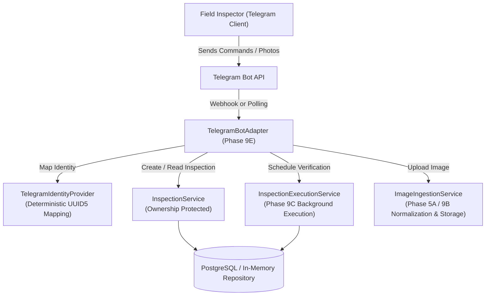

# Veriqoo Telegram Bot Integration Specification (Phase 9E)

**Status:** **ACTIVE & VERIFIED**  
**Target:** Telegram Client Adapter for Field Inspectors  
**Architecture:** Thin client adapter around existing FastAPI/Inspection services  

---

## 1. System Architecture



The Telegram integration acts strictly as a **thin client adapter**. It does **NOT**:
- Implement a separate OCR, Gemini reasoning, or RAG verification pipeline.
- Maintain a separate database or duplicate inspection state.
- Expose raw database connections or Supabase service-role keys to clients.

---

## 2. Authentication & Identity Boundary

### 2.1 Identity Invariant
Telegram `chat_id` or `telegram_user_id` is **never** used directly as a raw database `owner_id`.

### 2.2 Deterministic Cryptographic Mapping
The [`TelegramIdentityProvider`](file:///d:/Development/flutter/LegalMetrologyAI/backend/app/telegram/identity.py) uses a dedicated UUID5 namespace to map the integer `telegram_user_id` into a stable, non-forgeable UUID:

$$\text{user\_id} = \text{UUID5}(\text{NAMESPACE\_TELEGRAM}, \text{str}(\text{telegram\_user\_id}))$$

This produces an authoritative [`AuthenticatedUser`](file:///d:/Development/flutter/LegalMetrologyAI/backend/app/auth/models.py) context:
```python
AuthenticatedUser(
    user_id="7a2b3c4d-...",
    role="authenticated",
    email="tg_12345678@telegram.veriqoo.ai",
    claims={"telegram_user_id": 12345678, "role": "authenticated"}
)
```

### 2.3 IDOR & Cross-User Protection
- When Telegram User A calls `/new`, the resulting inspection is owned exclusively by User A's mapped UUID.
- If Telegram User B interacts with the bot, User B cannot read, upload photos to, execute, retry, or retrieve reports for User A's inspection.

---

## 3. Supported Commands & Workflow

| Command | Description | Preconditions | Output / Behavior |
|:---|:---|:---|:---|
| `/start` | Welcome message & overview | None | Explains Veriqoo and lists available commands. |
| `/help` | Detailed command guide | None | Displays step-by-step field inspection instructions. |
| `/new` | Initialize new inspection | None (clears stale) | Creates a new session in `COLLECTING` state. |
| *Send Photo* | Upload package photograph | Active `COLLECTING` session | Ingests, normalizes, and stores photo; increments sequence. |
| `/run` | Start compliance verification | Image count $\ge 1$ | Initiates Phase 9C background execution; status becomes `RUNNING`. |
| `/status` | Query current progress | Active session | Returns live persisted status (`COLLECTING`, `RUNNING`, `COMPLETED`, `FAILED`). |
| `/report` | Retrieve compliance report | Status is `COMPLETED` | Formats and sends concise compliance report with findings. |
| `/cancel` | Clear active conversation | None | Resets the Telegram chat state without corrupting database records. |

---

## 4. Image Processing & Normalization Flow

1. Inspector sends a photo via Telegram chat.
2. Telegram API offers multiple photo resolutions; the bot adapter selects the **highest resolution representation** (`update.message.photo[-1]`).
3. Bytes are downloaded from Telegram servers directly into volatile memory.
4. Bytes are passed to [`ImageIngestionService.ingest_bytes`](file:///d:/Development/flutter/LegalMetrologyAI/backend/app/services/evidence/ingestion.py):
   - Validates file signatures (JPEG, PNG, WEBP).
   - Enforces 25 MB and 32 MP safety limits.
   - Applies EXIF orientation correction.
   - Normalizes color profile to RGB PNG.
   - Computes SHA-256 source and normalized hashes.
5. Image is stored durably via the Phase 9B storage service (`SupabaseImageStorage` or `InMemoryImageStorage`).
6. Bot replies with sequence index and updated photo count.

---

## 5. Report Presentation

When verification finishes (`COMPLETED`), `/report` formats a structured, human-readable summary:

```text
✅ COMPLIANCE STATUS: PASS

• Inspection ID: 7c9e6679-7425-40de-944b-e07fc1f90ae7
• Summary: All statutory declarations verified compliant under PCR 2011.

📈 Counts Breakdown:
• Total Requirements Evaluated: 6
• ✅ Passed: 6
• ❌ Failed: 0
• ⚠️ Review Required: 0
• 👁️ Not Visible: 0
```

For non-compliant or borderline products (`FAIL` / `REVIEW_REQUIRED`), the top findings are highlighted with their statutory rule sources:
```text
❌ COMPLIANCE STATUS: NON-COMPLIANT (FAIL)

• Inspection ID: 7c9e6679-7425-40de-944b-e07fc1f90ae7
• Summary: Mandatory declaration violations detected.

📈 Counts Breakdown:
• Total Requirements Evaluated: 6
• ✅ Passed: 4
• ❌ Failed: 2
• ⚠️ Review Required: 0
• 👁️ Not Visible: 0

🔍 Key Findings & Observations:
1. ❌ R-6-1-c (Rule 6(1)(c)): Net quantity declaration missing standard metric unit.
2. ❌ R-6-1-d (Rule 6(1)(d)): Month and year of manufacture not clearly discernible.
```

---

## 6. Configuration & Local Execution

Configure via environment variables (`.env`):

```bash
# Telegram Bot Configuration
TELEGRAM_BOT_TOKEN="123456789:ABCdefGhIJKlmNoPQRsTUVwxyZ"
TELEGRAM_BOT_ENABLED=true
```

- If `TELEGRAM_BOT_ENABLED=false` or token is omitted, the Telegram adapter remains dormant.
- Test suites run with mocked adapters and **never** connect to Telegram servers or require live tokens.

